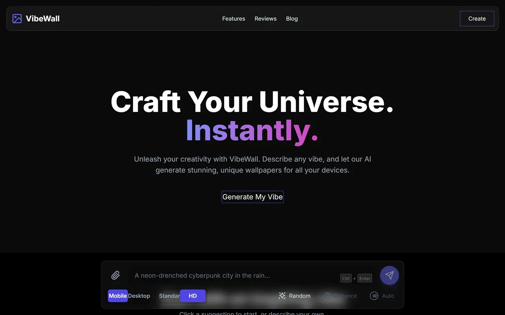

# Magic Wal Kit

**Creative browser utilities, canvas interactions and useful developer resources.**

    

## Overview

A collection of web tools and browser utilities exploring creative coding. The HTML, CSS and JavaScript project combines canvas animation with interactive resources for developers.

## The challenge

There were few fun, genuinely interactive web tools for creators and developers.

## The solution

A creative suite of browser-based utilities with distinctive animation and practical developer tools.

## Key features

- Browser utilities
- Canvas animations
- Interactive developer resources

## Tech stack

HTML5 · CSS3 · JavaScript

## Privacy

Client names and records are confidential. Every screen in this repository uses sample data, and source code that belongs to the client is not published.

## Links

- Case study on Lexvaxa: https://lexvaxa.com/work/magic-wal-kit
- Built by **Ch Muhammad Samiullah** ([GitHub](https://github.com/samiullah156-creator)) at [Lexvaxa](https://lexvaxa.com)
